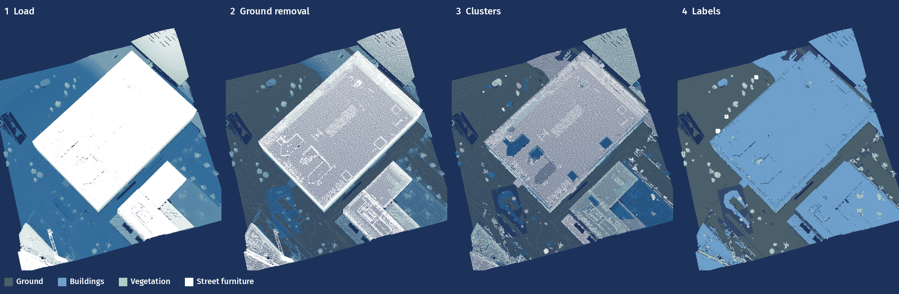

# 3D Data Science with Python (PyCon NL 2026)

Everything behind the 30-minute talk "3D Data Science with Python" by Sergio Peral at PyCon NL 2026 (15 October,
Jaarbeurs Utrecht): the Jaarbeurs hall in Utrecht and its surroundings, scanned from the air for AHN, turned into
labelled objects (ground, buildings, vegetation, street furniture) entirely in Python, plus the benchmarks behind the
performance and memory slides and the generator of the slide deck.



*One 200 m AHN5 crop around the Jaarbeurs hall in Utrecht (722 961 points), seen from above: the raw points,
the ground found by tiled RANSAC, DBSCAN clusters, and the final labels. Rebuild the picture with
`uv run python docs/img/make_readme_banner.py`.*

| | |
|---|---|
| Points in, after 0.5 m voxel downsampling | 722 961, 232 180 |
| Ground vs AHN class 2 | precision 0.98, recall 0.94 |
| Buildings vs AHN class 6 | precision 0.83 (a lower bound, AHN files many facade points elsewhere), recall 0.99 |
| Objects found | 58 building roofs, 683 vegetation clusters, 3 street furniture |
| Whole pipeline, load to paint-back | 0.6 s on one laptop |

## What is here

| Folder | What |
|---|---|
| `data/` | the 200 m AHN5 crop the talk uses (`utrecht_jaarbeurs_200m.laz`, 722 961 points), `fetch_ahn5.py` to download the 1 km AHN file and rebuild the crop, the data licence |
| `pipeline/` | the six-step pipeline (`steps.py`, `run.py`: load, voxel downsampling, ground removal, clustering, labelling, paint-back) and every render (`render.py`, one fixed camera) |
| `snippets/` | the code shown on the slides, each a runnable file that checks itself; `run_all.py` runs them all |
| `bench/` | the benchmarks behind the performance and memory slides (`bench_cliff.py`, `bench_memory.py`, free-threading, Scalene profiles, the remote COPC read and more); `_common.py` holds what they share |
| `results/` | the numbers the deck reads, one JSON per script (`pipeline.json`, `bench_cliff.json`, `memory.json`, ...; all FINAL except `research_facts.json`, PILOT) |
| `renders/` | the point-cloud images, label anchors and the render spec |
| `deck/` | the deck generator (`build_deck.py`, `lib/`), its inputs (`content.yaml`, `notes.yaml`, `appendix.yaml`), QA (`qa/`) and the built deck (`out/`) |
| `deck/ecosystem/` | the checked catalogue of the Python 3D ecosystem behind slide 4 and `docs/ECOSYSTEM.md` (`merge.py` builds both; logos in `deck/assets/logos/`) |
| `docs/` | QA notes, open items, timing, how to update, the README banner (`docs/img/`) and the research files the notes cite (`docs/research/`) |
| `tests/` | synthetic checks of `pipeline/steps.py` |
| `storyboard.md`, `CONTRACTS.md` | the approved storyboard and the interfaces between the parts |

## Run it

```bash
uv sync
uv run python data/fetch_ahn5.py        # only needed for the 1 km file (memory benchmark); the crop is included
uv run python pipeline/run.py           # results/pipeline.json
uv run python pipeline/render.py        # renders/
uv run python snippets/run_all.py       # every slide snippet
uv run python deck/build_deck.py        # the deck, from deck/template/pycon_nl_2026_master.pptx
```

`uv sync` installs the `deck` group only. The Scalene benchmarks, the scikit-learn benchmarks (`bench/eigen_features.py`,
`bench/cluster_alternatives.py`) and `deck/concepts/make_figures.py` need the rest: run `uv sync --all-groups` first.

The finished deck is in `deck/out/`, so building it is optional. `build_deck.py` and the QA render use the
`scripts/` folder of the Claude pptx skill (`add_slide.py`, `clean.py`, `office/validate.py`, `office/soffice.py`);
it is found at `$PPTX_SKILL_DIR` (default `~/.claude/skills/pptx`). The QA render also needs LibreOffice and
`pdftoppm`.

The full order, including the benchmarks (idle machine only) and the QA render, is in
[docs/HOW_TO_UPDATE.md](docs/HOW_TO_UPDATE.md). Python 3.13, NumPy, SciPy, laspy (with lazrs), Open3D and PyVista;
versions in `uv.lock`.

## Data licence

The point cloud is AHN5 (Actueel Hoogtebestand Nederland, ahn.nl) from Het Waterschapshuis, licensed under
[CC BY 4.0](https://creativecommons.org/licenses/by/4.0/). Attribution, wherever the data or anything derived from it is
shown:

> Point cloud: AHN5, Actueel Hoogtebestand Nederland (ahn.nl), Het Waterschapshuis, CC BY 4.0.
> AHN file 135000_455000, cropped and processed.

What was changed and where the licence is stated: [data/DATA_LICENSE.md](data/DATA_LICENSE.md). This project is not
endorsed by Het Waterschapshuis or AHN. The data licence does not cover the code: the code is MIT-licensed, see
[LICENSE](LICENSE). The logos in `deck/assets/logos/` belong to their owners (see its `SOURCES.md`) and are not
covered by the MIT licence.

## The slide design

A personal talk in the PyCon NL 2026 style: the conference's palette (navy, blue, sage and neutrals) and fonts
(Fira Sans, Fira Mono for code). The deck builds from `deck/template/pycon_nl_2026_master.pptx`, which
`deck/template/make_master.py` generates; sources, palette, contrast and rules are in
[docs/DESIGN.md](docs/DESIGN.md). Fira Sans and Fira Mono must be installed on the presenting laptop, or embedded with
PowerPoint's "Embed fonts in the file" before the deck travels. The PyCon NL logo is a labelled placeholder until the
file and the organisers' permission exist.

## Tests

```bash
uv run --group test pytest tests    # synthetic checks of pipeline/steps.py
```
